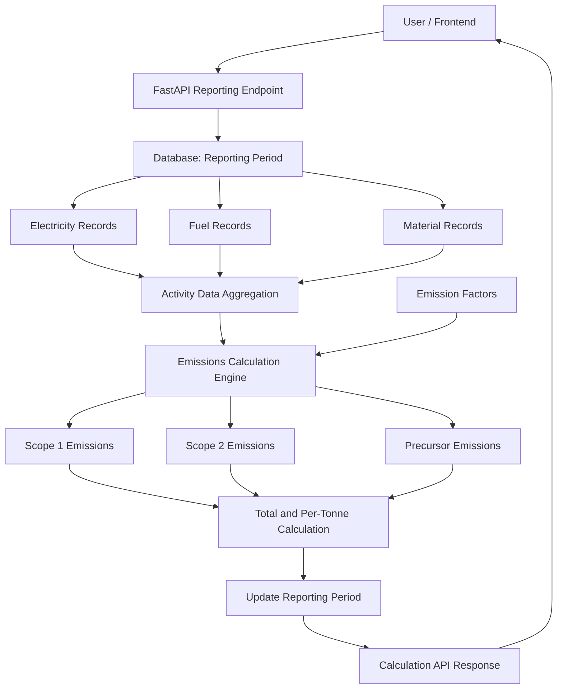
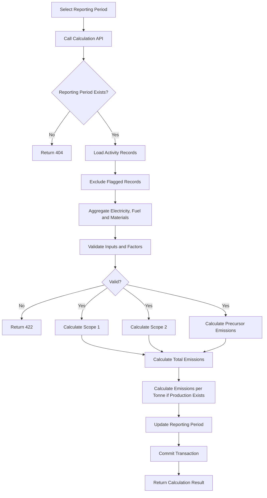
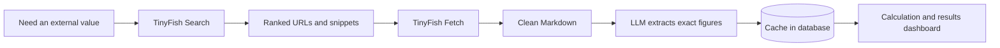

<div align="center">


**A deterministic, testable Python engine that calculates Scope 1, Scope 2, precursor emissions, total emissions and emissions intensity for a firm's reporting period.**


[Overview](#-01--overview) · [Architecture](#-03--system-architecture) · [Methodology](#-07--calculation-methodology) · [API](#-09--api-integration) · [Testing](#-11--testing) · [TinyFish](#-14--live-data-with-tinyfish) · [Roadmap](#-13--limitations--future-improvements)

</div>

> [!WARNING]
> The current `DEFAULT_EMISSION_FACTORS` are **placeholders, not verified values**. Results are suitable only for testing calculation behaviour and **must not** be used as verified emissions figures for external reporting.

---

## 📚 Table of Contents

| # | Section | # | Section |
|---|---------|---|---------|
| 01 | [Overview](#-01--overview) | 08 | [Input Data & Emission Factors](#-08--input-data--emission-factors) |
| 02 | [Objectives](#-02--objectives) | 09 | [API Integration](#-09--api-integration) |
| 03 | [System Architecture](#-03--system-architecture) | 10 | [Validation & Error Handling](#-10--validation--error-handling) |
| 04 | [End-to-End Workflow](#-04--end-to-end-workflow) | 11 | [Testing](#-11--testing) |
| 05 | [Technology Stack](#-05--technology-stack) | 12 | [Current Implementation Status](#-12--current-implementation-status) |
| 06 | [Project Structure](#-06--project-structure) | 13 | [Limitations & Future Improvements](#-13--limitations--future-improvements) |
| 07 | [Calculation Methodology](#-07--calculation-methodology) | 14 | [Live Data with TinyFish](#-14--live-data-with-tinyfish) |

---

## 🔎 01 · Overview

*What the engine does and why it is built this way.*

The platform collects business activity data: electricity consumption, fuel usage, purchased materials and production quantities. The calculation engine combines this data with the corresponding emission factors to estimate greenhouse gas emissions for a reporting period.

The engine keeps **calculation logic separate from database access and HTTP handling**. This makes the calculation function easy to test, while the API layer manages data retrieval, persistence and responses.

---

## 🎯 02 · Objectives

*What this component is meant to deliver.*

- ✅ Calculate Scope 1, Scope 2 and precursor emissions
- ✅ Calculate total emissions and emissions per tonne of production
- ✅ Validate quantities and emission factors
- ✅ Integrate the calculation function with the reporting API
- ✅ Persist calculation results on the reporting period
- ✅ Provide automated unit and endpoint tests
- 🔜 Support future integration with verified emission-factor sources and recommendations

---

## 🏗️ 03 · System Architecture

*How the layers fit together.*

The calculation flow follows a layered architecture.



### 🧩 Architecture Components

| # | Layer | Responsibility |
|---|-------|----------------|
| 1 | **Frontend** | Initiates reporting-period calculations through the backend API. Exact integration depends on the platform's existing implementation. |
| 2 | **API Layer (FastAPI)** | Exposes the calculation endpoint, validates the path parameter, retrieves reporting-period data, invokes the engine and returns the response. |
| 3 | **Data Access (SQLAlchemy)** | Loads the reporting period and its associated electricity, fuel and material records. |
| 4 | **Calculation Engine** | Lives in `app/domains/engine/engine.py`. Accepts activity data and emission factors, returns an `EmissionResult`. It never touches the database or the network. |
| 5 | **Persistence** | After a successful calculation, assigns totals to the reporting-period model and commits the transaction. |
| 6 | **Testing** | Pytest tests cover calculation behaviour and API endpoint scenarios. |

---

## 🔄 04 · End-to-End Workflow

*From a reporting-period request to a stored result.*



### 📝 Step by Step

1. The client requests calculation for a reporting period.
2. The API looks up the period and loads its activity records.
3. Records marked `FLAGGED` are excluded. `PENDING_REVIEW` and `CONFIRMED` records are included in the current implementation.
4. The API aggregates activity quantities by fuel and material type.
5. The calculation engine applies the supplied emission factors.
6. The engine calculates the individual emission categories and their total.
7. If production is available, the engine calculates emissions per tonne.
8. The API stores the resulting totals on the reporting period and commits the transaction.
9. The API returns a structured calculation response.

---

## 🧰 05 · Technology Stack

*The tools behind the engine.*

| Technology | Purpose |
|---|---|
| 🐍 **Python** | Calculation implementation |
| ⚡ **FastAPI** | HTTP API and endpoint integration |
| 🗄️ **SQLAlchemy** | Database models and asynchronous queries |
| ✔️ **Pydantic** | Request/response data validation |
| 🧪 **Pytest** | Automated testing |
| 🐘 **PostgreSQL** | Application database, as configured by the project |
| 🐟 **TinyFish** | Live web data (Search + Fetch) for emission factors, tariffs and policies, see [section 14](#-14--live-data-with-tinyfish) |

---

## 📁 06 · Project Structure

*Where the relevant code lives.*

```text
backend/
├── app/
│   ├── domains/
│   │   ├── engine/
│   │   │   ├── engine.py
│   │   │   ├── pathways.py
│   │   │   └── router.py
│   │   ├── reporting/
│   │   │   ├── models.py
│   │   │   ├── schemas.py
│   │   │   ├── router.py
│   │   │   └── service.py
│   │   └── activity/
│   ├── core/
│   └── main.py
└── tests/
    ├── test_engine.py
    └── test_calculate_endpoint.py
```

> This shows the relevant component layout, not necessarily every file in the repository. The active calculation endpoint may be registered through the reporting router, depending on the project's current routing configuration.

---

## 🧮 07 · Calculation Methodology

*The formulas. All outputs are in **tonnes of carbon dioxide equivalent (`tCO2e`)**.*

### 🔥 Scope 1: Direct Fuel Emissions

Fuel consumption is grouped by fuel type and multiplied by its emission factor.

```text
Scope 1 = Σ (Fuel Quantity × Fuel Emission Factor)
```

Supported fuels: `Diesel` · `Furnace oil` · `LPG`

### ⚡ Scope 2: Purchased Electricity

```text
Scope 2 = Electricity Consumption (kWh) × Electricity Factor (tCO2e/kWh)
```

### 🏭 Precursor Emissions

Purchased materials are grouped by material type.

```text
Precursor = Σ (Material Quantity (tonnes) × Material Factor (tCO2e/tonne))
```

Supported materials:

- Steel scrap
- Sponge iron DRI (coal)
- Sponge iron DRI (gas)
- Ferro manganese
- Ferro silicon
- Carbon additive

### ➕ Total Emissions

```text
Total = Scope 1 + Scope 2 + Precursor
```

### 📉 Emissions Intensity

When production is available and greater than zero:

```text
Emissions per Tonne = Total Emissions / Production Tonnes
```

If production is omitted, the engine returns `None` for emissions intensity.

---

## 📥 08 · Input Data & Emission Factors

*What goes in, and in which units.*

| Input | Unit |
|---|---|
| Electricity consumption | kWh |
| Fuel consumption | Litres, grouped by fuel type |
| Purchased materials | Tonnes, grouped by material type |
| Production quantity | Tonnes |
| Electricity factor | tCO2e/kWh |
| Fuel factors | tCO2e/litre |
| Material factors | tCO2e/tonne |

> [!IMPORTANT]
> Before calculated emissions are used in external reporting, the team must confirm the agreed methodology and validate factors against authoritative sources or supplier-specific data.

---

## 🔌 09 · API Integration

*How to trigger a calculation.*

### 🚀 Calculate Reporting-Period Emissions

```http
POST /api/reports/calculate/{period_id}
```

**What the endpoint does**

1. Retrieves the reporting period
2. Loads electricity, fuel and material records
3. Aggregates activity data
4. Calls `calculate_emissions()`
5. Saves the calculated totals
6. Returns a `CalculationResultResponse`

### 📤 Response Fields

| Field | Description |
|---|---|
| `period_id` | Reporting period identifier |
| `total_scope1_tco2e` | Total Scope 1 emissions |
| `total_scope2_tco2e` | Total Scope 2 emissions |
| `total_precursor_tco2e` | Total precursor emissions |
| `total_emissions_tco2e` | Scope 1 + Scope 2 + precursor |
| `specific_emissions_tco2e_per_tonne` | Emissions intensity (`None` if no production) |
| `recommendations` | Currently an empty list, as the pathways engine is not yet implemented |

### 🚦 Status Codes

| Status | Meaning |
|---|---|
| `404` | Reporting period not found |
| `422` | Invalid calculation input or missing emission factor, where handled by the endpoint |

Other failures, such as database connectivity issues or unexpected exceptions, depend on the application's error handling.

---

## 🛡️ 10 · Validation & Error Handling

*What the engine refuses to calculate.*

The calculation engine **rejects**:

- ❌ Negative activity quantities
- ❌ Non-finite quantities (NaN or infinity)
- ❌ Negative or non-finite emission factors
- ❌ Fuel or material types without a matching factor
- ❌ Zero, negative or non-finite production quantities, when production is supplied

An omitted production quantity is valid and results in a `None` emissions-intensity value.

---

## 🧪 11 · Testing

*What is covered, and how to run it.*

Tests live in `tests/test_engine.py` and `tests/test_calculate_endpoint.py`.

| Suite | Result |
|---|---|
| Calculation engine | ✅ **9 passed** |
| Calculation endpoint | ✅ **2 passed** |

### 🔬 Covered Scenarios

- Known calculation output
- Total emissions equal the sum of components
- Empty activity data
- Missing production quantity
- Invalid production quantities
- Negative quantities
- Missing emission factors
- Coverage of the supported model enums

### ▶️ Run the Tests

From the `backend` directory:

```bash
python -m pytest tests/test_engine.py -v
python -m pytest tests/test_calculate_endpoint.py -v
```

> Passing tests verify the covered scenarios. They do not, by themselves, prove that the full application is connected to the intended PostgreSQL database or that all end-to-end workflows work.

---

## 🚦 12 · Current Implementation Status

*Done versus still to do.*

### ✅ Implemented

- Deterministic calculation function
- Input validation
- Scope 1, Scope 2, precursor, total and per-tonne calculations
- Reporting-period calculation endpoint
- Persistence of calculated totals by the endpoint
- Unit tests and endpoint tests

### ⏳ Pending Verification or Implementation

- Verification and finalisation of emission factors
- Confirmation of the agreed emissions methodology
- End-to-end testing against the actual PostgreSQL database
- Recommendations / pathways implementation
- Export and download report implementations (currently placeholders in the reviewed router version)

---

## 🔭 13 · Limitations & Future Improvements

*The roadmap.*

- [ ] Replace placeholder emission factors with verified, sourced values
- [ ] Record factor source, version, effective date and units in the calculation record or snapshot
- [ ] Confirm whether pending-review activity records belong in official calculations
- [ ] Add end-to-end tests using a test database
- [ ] Implement the recommendations / pathways engine
- [ ] Complete report export and download workflows
- [ ] Add auditability for calculation inputs, factors and results

---

## 🌐 14 · Live Data with TinyFish

*Keeping emission factors and tariffs current instead of hard-coded.*

To ensure our carbon footprint calculations and renewable pathways are based on the latest real-world data, the application integrates **[TinyFish](https://www.tinyfish.ai/)**, a web agent platform that gives the app structured access to the live web.

Relying purely on static, hard-coded emission factors or tariffs quickly leads to outdated calculations. TinyFish lets us dynamically retrieve the most current compliance rules, grid emission factors and local utility tariffs, without building complex, fragile web scrapers.

### 🔧 How We Use the TinyFish APIs

TinyFish provides several endpoints (Search, Fetch, Agent and Browser). The application primarily uses the **Search** and **Fetch** endpoints, which work together to find and extract clean data.



| # | Endpoint | Role |
|---|----------|------|
| 1 | **TinyFish Search** | Finds the right URLs when there is no direct link, for example a supplier's published sustainability report or a state's latest open-access renewable policy. Returns structured JSON with ranked URLs and snippets. |
| 2 | **TinyFish Fetch** | Takes the target URLs, renders the page (including JavaScript-heavy sites), strips out cookie banners and navigation, and returns clean Markdown. This text is passed to our LLM to extract the exact numerical figures. |

### 🎯 Core Use Cases

Every time the app fetches external evidence, it stores the **value together with its source URL, a timestamp and the factor version**, to maintain strict traceability.

| Use case | What is retrieved |
|---|---|
| ⚡ **Grid Emission Factors** | The latest Central Electricity Authority (CEA) grid baseline emission factors |
| 💰 **State Electricity Tariffs** | Current industrial tariff rates for the user's state, to calculate the financial impact of shifting to renewables |
| ☀️ **Solar Yield Data** | Local solar irradiance data (for example kWh/kWp for the Delhi region) to compute realistic rooftop solar generation capacity |
| 📜 **Renewable Policies** | State-specific rules for open-access or group captive power eligibility, which often depends on contracted demand |
| 🏭 **Supplier Emissions (Precursors)** | Published Scope 1/2 emission data of sponge iron and ferroalloy suppliers, found with Search + Fetch |

### 🗄️ Caching and Fallbacks

The app does not strictly depend on live web fetching for every calculation. Every value retrieved via TinyFish is **cached in the database**.

- ⚡ **Fast loading:** if a recent, valid value exists in the cache, the app uses it immediately.
- 🛟 **Resilience:** if the live fetch fails (for example, a target website is down), the app falls back to the most recent cached factor and flags its timestamp on the results dashboard.

> [!NOTE]
> In the current frontend prototype, the "Sync live factor" button on the setup screen is not yet connected to the backend, so no live emission factor is retrieved from the UI yet. Until verified factors are plugged in, the engine's `DEFAULT_EMISSION_FACTORS` remain placeholders (see the warning at the top).

---

<div align="center">

**⚠️ Disclaimer:** This component's current emission-factor values are placeholders. Results generated with them are suitable only for testing calculation behaviour and must not be treated as verified emissions figures for external reporting.


</div>


### Developers
* Anshu Kashyap 
* Som Kashyap 
* Kanishka Upadhyay 
* Anushka Goel
##### Team QuadCore
